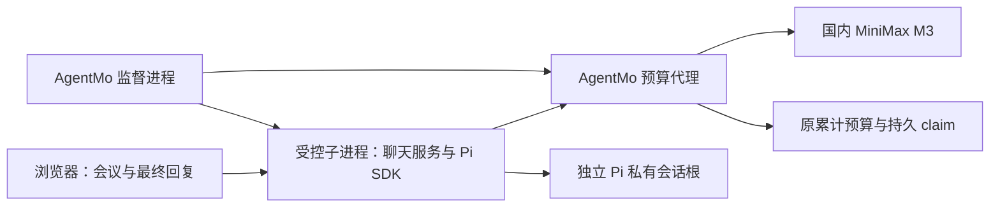

# Task 6：会议文字助手迁移到 Pi SDK

日期：2026-10-16。状态：SDK方向已获批准；本文为待用户审阅的正式规格。
本文不是实施计划，也不是AgentMo正式Plan approval、依赖安装、Agent安装、激活或模型调用授权。
用户要求保留浏览器入口和原累计预算；不读取密钥，不提交或push。

## 1. 要交付的结果

将当前`meeting-text`会议文字助手从OpenClaw载体迁成独立Pi Agent：
浏览器输入会议材料，Pi官方SDK负责会话和Agent运行，AgentMo代理执行预算和M3协议边界。
用户仍能查看最终回复、更正行动项、切换会议，并在获批重启后恢复原会议。
摘要、决策、行动项、未决问题的内容要求，以及未知值不得臆造的规则保持不变。

成功必须同时满足：正式Discover → Plan → Produce来源链能产生并验证Pi Package；
实际运行路径不启动或调用OpenClaw；浏览器显示真实Pi会话的最终回复；
预算、批准消费、隔离和19类验收证据均对应这份Pi交付。
SDK导入成功、配置出现`pi`、HTTP 200或进程退出0均不能单独证明迁移完成。
领域认证、生产批准仍不在本次迁移范围内。

只迁移当前会议助手。保留旧OpenClaw实现、状态、失败证据和其他调用者；
不做通用多载体插件框架、终端入口、远程访问、多用户、上传、工具市场或调度系统。

## 2. 基线与历史边界

| 事实 | 当前值与含义 |
| --- | --- |
| 开发工作树 | `.worktrees/course-wiki`，`codex/course-wiki`，HEAD `9e59ff7fc59bc15f42a557e18232ab41ee9412e5` |
| 已安装载体 | OpenClaw 2026.9.4；当前已停止，尚无独立Pi安装或运行根 |
| 模型 | 国内按量API，`minimax-m3-cn-v1` / `MiniMax-M3` |
| 真实M3结果 | 首例一次发送，客户端502，无最终回复；未重试、未执行其余四例或受控重启 |
| 预算 | 原账本26项项目预留；累计4774分保守预留、5226分可用、总上限10000分 |
| 交付 | PARTIAL；旧15项来源缺口、19类验收完成条件未闭合 |
| 产品源码冻结 | 98文件，SHA-256 `f0c045f8a940020ca1732ba92e91217431013a4adb3a7763a515634934bb4b10` |

预算数值是写规格时的观察，不是可重置的初始余额或供应商账单。
冻结清单见[源码快照](../../handoffs/2026-10-14-native-m3-source-snapshot.json)。
后续实施会生成新的源码证据；不得覆盖旧快照使旧回执看起来适用于新代码。

OpenClaw单次诊断提案`sha256:11b1a336be6759ceca285bae0e63eb7b75e5b2de6e363b9b21a1b3b9b1444f63`
曾获批准，但迁移指令到达时尚未签发新决策、启动或发送消息。
保留批准历史，当前不执行；它不能授权Pi安装、激活或请求。
迁移不证明已定位或修复502：现有证据没有实际上游HTTP状态，根因仍未知。

## 3. 选定结构与进程边界

采用官方SDK嵌入受控子进程，不暴露Pi CLI或RPC。浏览器页面使用本仓库提供的本地聊天界面，
不再依赖OpenClaw网关页面。静态HTML、CSS、JavaScript及Node HTTP服务即可完成当前需求。

监督进程负责准入、启动、健康检查、批准的操作范围和鉴权停止；预算代理独占真实供应商凭据。
只有获得后续具体运行批准的环境文件加载器可以在内存加载`MINIMAX_API_KEY`。
Pi子进程只得到本机代理token、固定模型配置、私有目录及必要控制信息，
不继承真实key、其他供应商凭据或环境文件路径。浏览器不接触这些凭据或代理token。
运行器以显式环境白名单启动子进程；不把整个父进程环境原样传入。
`--runtime-env-file`仍是AgentMo唯一公开运行环境文件选项。

该边界降低意外继承和旁路请求风险，不声称构成同UID操作系统安全沙箱。
父子进程仅按已验证绑定通信，不允许浏览器指定上游、模型、磁盘路径、命令或任意SDK选项。

否决RPC方向：需要额外控制命令和默认资源加载，当前单Agent浏览器需求用SDK更直接。
否决复制或维护Pi/OpenClaw分支；否决只改旧配置的runtime名称或复用旧回执。
若固定SDK不能满足本规格，停止并提出明确规格修订，不静默降级控制或改走其他载体。

## 4. SDK与兼容性

设计固定`@earendil-works/pi-coding-agent@1.2.0`，依据官方`v1.2.0`源码核对接口。
这是版本选择，不是已观察到npm制品完整性或已安装目标的声明。
实际安装前须准备依赖安装预览：规范目录、registry来源、固定版本、npm integrity、
锁文件及传递依赖闭包、磁盘操作、命令、是否执行脚本和停止条件。
默认不执行安装脚本；确需构建的操作必须逐项列出后批准。禁止全局安装、隐式升级或借用旧OpenClaw依赖冒充独立Pi。
安装成功后验证实际包闭包、入口和Node身份，形成可复查回执，才可生成绑定真实目标的后续Agent安装计划。

SDK要求Node >=22.19.0。AgentMo原Node 20核心和既有分发信任策略保持不变：
Pi只由单独核验的兼容Node进程延迟导入，Node 20核心不得静态加载该依赖。
实际Node版本、可执行文件摘要、SDK版本与闭包摘要进入Pi目标描述及运行回执。
不能凭本机一个可用Node推断其他机器兼容；不接受环境变量覆盖仓库Node 20信任锚。

使用`createAgentSession`、明确的`ModelRuntime`、`SettingsManager.inMemory`和官方`SessionManager`。
显式资源加载器只提供Package中的会议规则，不发现全局或项目的技能、扩展、模板、上下文文件、模型或认证文件。
`cwd`、`agentDir`、auth/models路径、session路径全部落在获批的私有Pi根；不得回落到用户现有Pi配置。
system prompt以Package规则为准，不注入默认编码助手规则、本机路径或环境信息。
本地provider使用代理静态凭据，不启用OAuth、登录刷新或供应商密钥探测；健康检查不得调用模型接口。

| 运行能力 | 固定策略与可验证结果 |
| --- | --- |
| 模型 | 仅`agentmo-budget/MiniMax-M3`，SDK provider为本地代理；无默认模型、候选列表或fallback |
| 工具 | `tools: []`、`customTools: []`、`noTools: "all"`；含MCP的有效工具集合为空 |
| 资源与遥测 | 不加载扩展/skills/prompts/MCP；关闭安装遥测、analytics及更新联网 |
| 思考与内容 | thinking off，纯文本，无图片、附件、工具调用或命令执行 |
| 会话重试 | retry disabled，maxRetries=0 |
| provider重试 | provider retry maxRetries=0；独立核对有效请求选项 |
| 缓存预热 | 构造内存settings时设置cacheWarming=off，核对有效getter；不能只靠后加override |
| 自动上下文动作 | 关闭自动compaction、溢出恢复、摘要和继续队列；不暴露人工摘要或分支操作 |
| 材料解释 | `prompt`明确禁止模板/扩展命令展开；`/`、`@file`、shell前缀和注入文本都作为文字 |

不得照抄示例默认设置。两层重试、预热、资源加载及其他联网入口必须用实际固定SDK加受控模拟验证。
无法确认有效禁用时启动失败，不进入可发送状态。

官方依据：[包与Node要求](https://raw.githubusercontent.com/earendil-works/pi/v1.2.0/packages/coding-agent/package.json)、
[SDK工厂](https://raw.githubusercontent.com/earendil-works/pi/v1.2.0/packages/coding-agent/src/core/sdk.ts)、
[设置管理](https://raw.githubusercontent.com/earendil-works/pi/v1.2.0/packages/coding-agent/src/core/settings-manager.ts)、
[预热实现](https://raw.githubusercontent.com/earendil-works/pi/v1.2.0/packages/coding-agent/src/core/cache-warmer.ts)。

## 5. 正式来源链与载体身份

沿用`execution_profile: "native-chat"`，新增封闭选择字段`native_runtime`：
显式值仅支持`"pi"`；缺省保持历史OpenClaw解释及原序列化字节。
非native-chat输入出现此字段、null、未知值或选择与target/runtime不一致，均在批准消费和写入前拒绝。
不从自然语言、已装软件或环境推断Pi。模型仍必须显式选择`native_model_profile: "minimax-m3-cn-v1"`；
本次Pi分支只支持该组合，其他模型不随迁移自动开放。

1. **Discover / Need：** 新Pi Need保留任务、固定材料、来源和缺口，显式选择Pi与M3；
   新Discover快照保留来源摘要。旧来源可被引用为历史，不能改标签变成Pi运行证据。
2. **Plan：** Design Plan、Blueprint Draft和Blueprint逐项携带同一选择；
   `targetRuntime` / runtime / target为Pi，工具和specialists为空。真实用户批准仍绑定确切来源和规划摘要。
3. **Build Contract / Produce：** `target: "pi"`通过实际Pi adapter生成固定运行资源和浏览器资源；
   目标描述绑定SDK/Node及实际文件闭包。Package manifest、归档、carrier admission及运行specification互相核验。
   `.d42`归档流程复用，不能以OpenClaw carrier投影伪装Pi。
4. **生命周期：** 注册Pi专属`pi-target-descriptor`、`pi-install-plan`、`pi-install-approval`、
   `pi-install-receipt`工件身份；`pi-install-plan`明确区分install和activate动作。
   精确操作、状态根、目标、Package、预算、普通写入、敏感命令、冲突决策均绑定摘要。
   复用私有安全文件和持久authority机制；OpenClaw与Pi分别调用各自严格验证器，禁止宽松fallback。
5. **验收 / Delivery：** 使用`pi-native-chat-acceptance`及Pi安装来源subject；
   native-chat delivery按确切载体分派完整来源集合，拒绝拼接OpenClaw回执、激活plan或观察。

新的Pi native binding包含载体、Agent、model profile、正式Package来源、目标、私有根和原预算引用。
它参与安装/激活身份、批准消费、请求claim、观察和报告绑定。
每次读取都准入实际工件，不能只比较调用者自述字段。
既有旧工件的schema、字节、缺省和错误边界保持兼容；新增Pi字段不得被旧分支静默忽略。

## 6. 浏览器与私有会话

第一版页面提供会议列表、新会议、消息区、文本输入、发送和停止；
显示会议文字助手、MiniMax M3、当前会议和只读/可发送/处理中/完成/失败状态。
输入标签、键盘操作、焦点和状态播报可用。错误说明是否已发送及是否可能有预留，不显示供应商正文或原始异常。
回复按文字安全渲染，禁止将模型HTML、链接或指令作为页面脚本执行。

只监听`127.0.0.1`。19492/19493是聊天/代理候选端口，真正端口和全部控制入口在激活预览中绑定；
占用时失败，不改端口重试、不接管旧服务。静态资源本地提供，无CDN、外部分析或第三方脚本。
页面初始只提供登录；获批运行器向用户提供临时访问口令，页面同源POST交换为内存会话对应的
HttpOnly、SameSite=Strict cookie。口令不放URL、localStorage、证据或普通日志；助手不读取其值。
API检查精确Host、Origin、认证和请求形状，不开启跨域。登录有次数限制。
消息、会话、事件流和停止接口均鉴权；缺Origin的浏览器变更请求拒绝。

最小API只负责创建/列出/读取本Agent会话、提交一条材料、读取运行事件与状态、鉴权停止。
只接受不透明会话ID和由服务端准入的turn ID；禁止客户端提供文件路径、Agent配置或SDK命令。
事件流断线仅恢复观察，不重新提交、重新生成或调用模型；启动、登录、切换、刷新和健康检查为零模型操作。
全入口一次最多处理一个turn，不实现排队、steering、follow-up或并发生成。

每个会议使用官方SessionManager在独立私有根创建/恢复真实上下文，不手工替换`agent.state.messages`伪造持久会话。
新会议不读取旧会议或OpenClaw会话；只加载同一正式交付根中登记过的Pi会话。
拒绝路径穿越、符号链接、错误所有者/权限、根身份或安装快照漂移。
目录0700、数据文件0600；Pi运行会话可以包含用户材料和回复，仅作为私有运行数据。
不将这些正文、全会话或原始供应商载荷复制进Git、release或验收证据。
上述会话文件和认证入口的实际创建、写入与检查范围必须出现在对应安装/激活/验收预览中。
重启恢复只读取已存在上下文，不自动prompt、续跑、补发或释放旧claim。

## 7. 一次提交、预算和M3适配

复用当前项目的原预算引用与账本，不新建迁移预算、不退款、不删除旧slot/claim，不将失败当作免费。
单次通过预算准入的上游尝试仍预留31分，累计总上限10000分。
`reserved`只证明预留，不证明供应商收到了请求、真实账单或语义成功。

激活分为只读与获批用例模式。只读激活的服务端拒绝发送。
获批批次绑定具体预览中的材料摘要、会话路由、最大次数、是否允许一次重启和失败停止规则；
控制侧核对后才放行，不把“启动了聊天页面”解释为任意模型调用授权。
已消费次数/失败状态跨重启保留，批次结束或首个失败后关闭发送；新批次须有新具体预览批准。

浏览器提交经鉴权与输入验证后，服务端先持久登记绑定当前会话、turn和材料摘要的记录，再调用SDK。
代理核对该记录、获批范围和实际请求，排他取得持久claim后才预留并发送。
相同turn重送只返回已存状态；同turn不同正文或第二个上游请求拒绝。
崩溃留下的不确定turn标为interrupted，不能重发或通过新turn自动补跑。
现有不同载体的claim都保留；Pi claim包含自己的载体/会话/turn/请求摘要，不混用旧键，也不跨会议复用回复。

SDK使用固定的本地OpenAI completions provider；实际wire由固定SDK的模拟集成捕获并核对。
代理仅接收已知形状，规范化为M3固定请求，不允许通过宽松透传兼容未知SDK字段。

| 边界 | 固定规则 |
| --- | --- |
| 唯一上游 | `https://api.minimax.cn/v1/chat/completions`，model=`MiniMax-M3` |
| 供应商参数 | standard、thinking disabled、n=1、max_completion_tokens=2048 |
| 用户文本 | 非空，最新材料最多8000 Unicode码点，不按UTF-16长度计算，不截断 |
| 整体请求 | 含system与历史，最多48KiB、32条消息；边界验证在预留前完成 |
| 使用量边界 | 保留现有输入53248 / 输出2048 tokens校验及31分策略，不借迁移放宽 |
| 未知结构 | 附件、工具、未知字段、其他模型/地址、fallback在花费前拒绝 |
| 响应 | 保留流式/JSON、usage、model、finish、纯文本和上限校验，禁止把错误或不完整流当最终回复 |

SDK、HTTP客户端、代理和控制侧均不重试。超时、断流、429、5xx和协议失败停止当前批准批次。
若实际SDK wire无法通过严格边界，集成测试失败；先修明确适配或重新审阅规格，不能禁用校验。

## 8. 完成、失败和诊断语义

先订阅SDK事件再提交；增量文字仅用于显示处理中状态。
成功必须出现当前turn的最终assistant `message_end`、可接受的完整纯文本/usage，
并到达`agent_settled`且未中止；最终stopReason只接受正常stop。
截断、工具调用、error、aborted、缺最终消息或缺settled均失败。
单独`agent_end`、promise resolve、进程退出0或页面有部分文字不能置success。
判为成功后仍须独立内容评审，不能把运行成功替代内容合格。

turn状态顺序为received → reserved → sent → completed；任何阶段可终止为failed/interrupted。
sent表示本地发起上游传输，不认证供应商已接收；reserved但未sent仍保留预留。
SDK最终回复已持久化但观察中断时只能从相同Pi会话恢复显示和核对，不发新请求。
无法证明最终状态时保持不确定，不补造成功记录。

诊断只保存有界阶段、枚举causeCode、实际HTTP状态（若确有观察）、耗时、计数及来源/turn摘要。
区分本地验证失败、上游非2xx、网络失败和2xx后的响应协议失败；未观察到的状态留空。
不记录任意异常message、原始headers、URL查询、key、材料、回复、供应商正文或SDK stdout/stderr。
不能由客户端502或SDK通用文案推断供应商500。

停止仅针对本次持有控制身份的资源；使用鉴权控制接口和既有所有权核对，不按裸PID杀进程。
启动失败、首个用例失败、超时或预算/来源漂移时停止自有资源并保留现场，不自动重启或补跑。
受控重启必须写入同一具体预览，停止后核对计数及身份，再恢复同一Pi会话。
停止与清理不得删除会话、批准消费、attempt、预算或失败证据。

SDK事件依据：[固定版本AgentSession](https://raw.githubusercontent.com/earendil-works/pi/v1.2.0/packages/coding-agent/src/core/agent-session.ts)。

## 9. 必须覆盖的接口范围

以下是设计的传播边界，不是已批准的实施步骤；下一份实施计划再指定改动、测试及执行方式。

| 现有职责 | 必须覆盖的调用者和产物 |
| --- | --- |
| Need / Stage 2 | user-need、design-plan、blueprint-draft、blueprint、摘要/报告、正反例与Stage 2契约 |
| 目标 / Package | targets registry与Pi adapter、Build Contract、package projection/manifest/carriers、归档准入、目标描述 |
| 生命周期 | Pi plan/approval/receipt、公开CLI帮助、artifact registry/contracts/loader、exports和持久authority分派 |
| 运行 | 独立Node入口、受控Pi SDK、浏览器静态资源/接口、监督和鉴权停止、私有SessionManager状态 |
| 预算 / 协议 | native-chat-proxy对Pi的严格绑定、course-wiki-budget复用、持久claim/turn、M3适配与安全诊断 |
| 验收 / 交付 | behavior-evidence定义和路由、Pi acceptance、delivery-report及完整来源集合、独立内容评审 |
| 兼容 / 分发 | 包含新资源的Package I/O与文件清单、Node 20生产器/消费者归属、运行兼容性行、文档/发布证据 |

优先复用安全文件、预算预留、严格协议和归档加载机制；只为Pi身份及生命周期增加必要分支。
不把现有OpenClaw验证器改成接受任意runtime，不顺带重构整个registry或预算系统。

## 10. 验证与验收标准

**无需真实安装/激活的离线检查：** 新selector完整传播与冲突拒绝；旧工件重建字节和行为不变；
真实来源准入、归档/Package I/O、批准消费顺序；伪装Pi或拼接旧回执失败且零写入/零消费；
预算去重、并发和崩溃恢复用全合成账本；材料、回复、未知异常和key样本不得流入证据。
现有Stage 2契约、support-triage birth-loop、完整`npm run check`及`git diff --check`按改动范围完成。
Node 20必须按仓库受信Node、全新临时收据及发布后消费者顺序验证，不能复用旧成功证明新代码。

**依赖安装获批后才能验证的固定SDK集成：** 真实固定SDK连接本地模拟上游，
核对有效settings、实际请求/事件与会话文件；覆盖所有禁用能力。
断流、401/429/500、超时及畸形响应每次最多一个请求；无预热、重试或摘要请求。
在启动、处理中、settled后及超过SDK预热计时窗口的空闲期统计出站请求；
切换/恢复/刷新、SSE重连、崩溃重启均不能新增模型尝试。
合成`/命令`、`@file`、注入和假密钥验证没有文件读取、权限扩大或正文泄漏。
这些检查不是当前已执行结果，安装本身及启动本机服务仍须先给具体预览批准。

**真实浏览器验收：** 保留19类要求及固定内容评审标准，但新定义、执行、观察、review、
目标和会话摘要必须绑定Pi；旧OpenClaw观察不能计为Pi通过。

| 类别 | 要证明的行为 |
| --- | --- |
| entry / correction / injection / fresh-session / restart | 真实M3最终回复、四类会议内容、更正准确、注入无副作用、新会话隔离及同会话重启恢复 |
| empty-input / over-limit-input / at-limit-input | 空/8001码点拒绝，8000非BMP码点完整保留；拒绝前零预留 |
| full-request-limit / history-limit / unknown-structure | 完整请求和历史严格限额，未知结构花费前拒绝，不伪造上下文夹具为页面证据 |
| provider-429 / provider-500 / provider-timeout / provider-disconnect | 批准的模拟上游故障可见，每例单一尝试，预留不退款、不假成功 |
| budget-duplicate / budget-concurrency / budget-recovery | 同turn不重发，排他预算，崩溃不重置或重放 |
| state-protection | 外部端口、旧服务、错误身份和未知状态不接管 |

五条真实模型材料仍为原固定合成用例；未来候选预留最多155分，包含重启追问，不能使用旧批准执行。
其余14类使用新的具体模拟验证预览；若需要准备历史，逐项列出调用、会话及预留上限，不能默认沿用旧次数。
模拟预留也不从真实账本退款。真实模型失败即停止，不补跑；旧502不在迁移中偷偷重试。
独立内容评审只在获批操作中对实际可见最终回复进行，保存有界结论与摘要，不保存正文。

缺来源、未执行、观察不完整或评审失败时delivery保持partial / nativeEntryVerified=false。
19类完整且绑定匹配后才允许entry-verified；domainCertified、deliveryReady、productionApproved仍false。
旧15项缺口保留逐项状态，新Pi来源缺口另外列明，禁止因为换载体而清零。

## 11. 批准顺序与交付边界

当前批准仅覆盖SDK方向与写本文。完成自审后先请用户审阅本文；
书面规格获批才写实施计划，实施计划获审阅并选定执行方式后才进入实现。
后续真实动作按顺序各自提供可复核的字节/摘要与作用范围：

1. 固定Pi SDK/Node工具链的具体安装预览；实际安装回执不能预先伪造。
2. 新Pi正式Discover、Plan与Produce各门禁；产出Package及载体来源，不能把本设计批准冒充其批准。
3. 若需新authority存储，先预览实际初始化范围；再用真实存储身份生成Agent安装预览。
4. 新私有状态根的精确安装计划，列出全部文件、权限、命令、冲突、来源和预算引用。
5. 激活与只读浏览器检查预览，列出端口、进程、内存凭据加载、停止路径与零模型/零预留预期。
6. 具体模型/模拟验收预览，列出固定输入摘要、路由、次数、最大新增预留、当前累计余额、重启和失败停止规则。

规格、实施计划、独立审阅和离线通过都不替代上述运行授权。
本次不提交、不push、不发布、不读取环境文件或密钥；不初始化Pi运行根、不安装或启动任何新服务。
文档与值盲核验完成后保留待审阅状态，继续任务的入口是本文和[当前状态](../../CURRENT_STATUS.md)。
